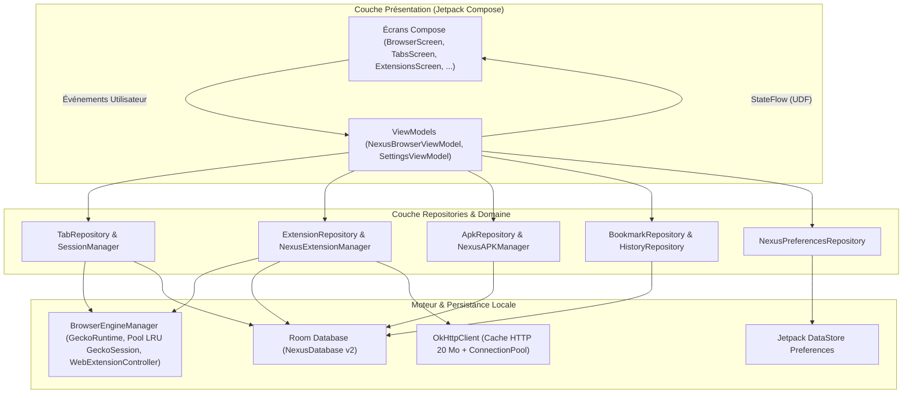

# Architecture Technique — NEXUS Browser

Ce document détaille l'architecture logicielle de **NEXUS Browser** (`com.nexus.browser` v1.1.0), ses couches applicatives, le flux de données unidirectionnel (UDF), les optimisations de performances et l'intégration native du moteur **Mozilla GeckoView**.

---

## 1. Principes Architecturaux

NEXUS Browser repose sur **Clean Architecture** combinée au pattern **MVVM (Model-View-ViewModel)** et à l'injection de dépendances via **Dagger Hilt** :

1. **Présentation (`ui/`, `settings/`, `core/designsystem/`)** :
   - Écrans déclaratifs **Jetpack Compose** et composants **Material 3** (`NexusButton`, `NexusSearchBar`, `NexusToolbar`, `NexusBottomNavBar`, `NexusTabCard`, `NexusExtensionCard`, `NexusDownloadCard`, etc.).
   - `NexusBrowserViewModel` et `SettingsViewModel` exposent des états immuables (`@Immutable`) via `StateFlow` et reçoivent les intentions utilisateur.
   - Aucune requête SQL ni manipulation directe de `GeckoRuntime` n'est effectuée dans les écrans Compose.
2. **Domaine & Contrats (`browser/engine/BrowserEngineContract.kt`)** :
   - Interfaces découplant les consommateurs UI/ViewModel des implémentations techniques (moteur GeckoView, analyseur de compatibilité d'extensions).
3. **Données (`repository/`, `core/database/`, `core/preferences/`)** :
   - **Repositories** (`TabRepository`, `BookmarkRepository`, `HistoryRepository`, `ExtensionRepository`, `ExtensionStoreRepository`, `ApkRepository`, `NexusPreferencesRepository`) centralisant la persistance et la synchronisation avec le moteur.
4. **Core & Moteur (`browser/engine/`, `core/security/`, `core/network/`)** :
   - Singleton `BrowserEngineManager` orchestrant `GeckoRuntime`, le pool LRU de `GeckoSession` par onglet, les délégués GeckoView et le `WebExtensionController`.

---

## 2. Intégration du Moteur Mozilla GeckoView & Optimisations Mémoire

Contrairement aux navigateurs basés sur `android.webkit.WebView`, NEXUS Browser utilise **Mozilla GeckoView (`org.mozilla.geckoview:geckoview-arm64-v8a:130.0.20240913135723`)**, embarquant son propre moteur de rendu Gecko, son moteur JavaScript SpiderMonkey et une implémentation native de l'API **WebExtensions**.

### 2.1 Cycle de vie `GeckoRuntime`, Pool LRU `GeckoSession` et `onTrimMemory`
- **`GeckoRuntime`** : Instancié de manière paresseuse (`lazy`) une seule fois par processus applicatif dans `BrowserEngineManager` avec `GeckoRuntimeSettings.Builder()`.
- **Pool LRU de `GeckoSession`** :
  - Chaque onglet actif possède sa propre `GeckoSession`.
  - Pour éviter la saturation de la RAM lorsque de nombreux onglets sont ouverts, `BrowserEngineManager` maintient un **pool LRU (`MAX_OPEN_BACKGROUND_SESSIONS = 5`)** : les sessions en arrière-plan les plus anciennes sont automatiquement fermées (`session.close()`) tout en conservant leur état dans `BrowserTab`, et sont recréées à la demande dès que l'utilisateur revient sur l'onglet.
  - En cas de pression mémoire signalée par Android (`MainActivity.onTrimMemory`), les sessions inactives en arrière-plan sont immédiatement libérées.
- **Navigation Privée** :
  - Les onglets privés sont créés avec `GeckoSessionSettings.Builder().usePrivateMode(true).build()`, garantissant qu'aucun cookie, cache ou stockage DOM n'est partagé avec les sessions normales ni écrit sur disque.

### 2.2 Persistance Debounced des Onglets
- Pour éviter les écritures SQLite excessives lors des événements de progression de chargement (`onProgressChange`, `onTitleChange`), `TabRepository` regroupe et diffère (`persistNormalTabsDebounced`, 350 ms) la sauvegarde des onglets normaux dans Room.

---

## 3. Schéma de Base de Données Room (`NexusDatabase` v2)

La base SQLite gérée par Room (`nexus_browser.db`, version 2 avec migration automatique `MIGRATION_1_2`) regroupe **7 entités** annotées `@Immutable` :

| Table Room | Entité Kotlin | Rôle |
|---|---|---|
| `tabs` | `TabEntity` | Persistance des onglets normaux, onglets épinglés et ordre d'affichage (les onglets privés en sont exclus). |
| `bookmarks` | `BookmarkEntity` | Favoris avec dossiers et recherche rapide. |
| `history` | `HistoryEntity` | Historique horodaté avec compteur de visites (`visitCount`). |
| `home_shortcuts` | `HomeShortcutEntity` | Raccourcis personnalisables et réorganisables de la page d'accueil NEXUS. |
| `downloads` | `DownloadEntity` | Suivi temps réel des téléchargements, taille, statut et chemin local. |
| `extensions_metadata` | `ExtensionMetadataEntity` | Registre des extensions installées (intégrées, locales `.xpi`, ou catalogue Mozilla), version, permissions et état d'activation. |
| `site_permissions` | `SitePermissionEntity` | Décisions de permissions mémorisées par origine (`origin` + `permissionType`). |
